# Flame in Freefall: Project Details

**Live site:** https://firerium.onrender.com · **Code:** https://github.com/yahia-svg/Firerium

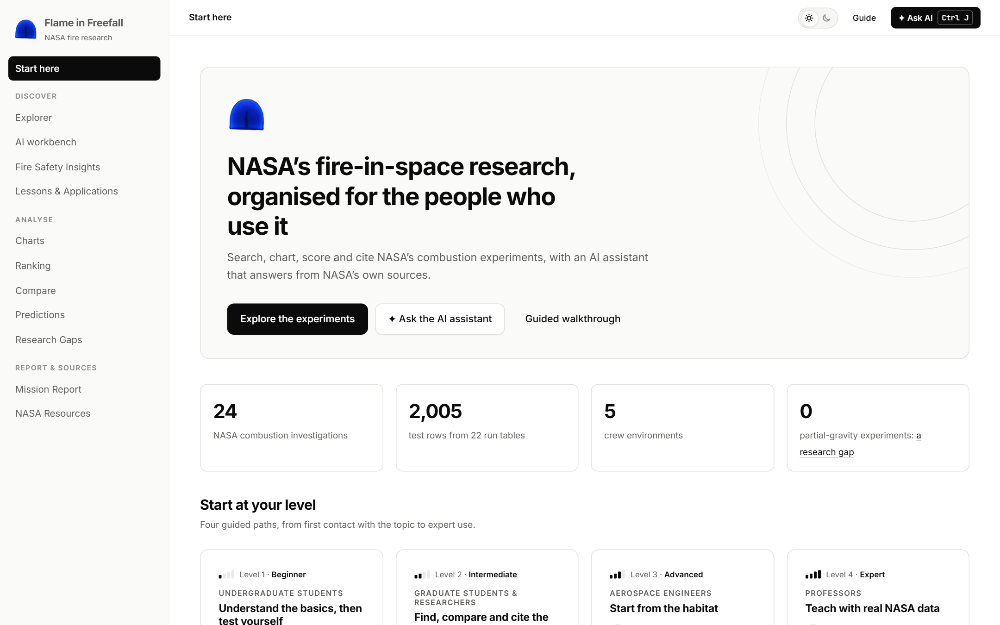

## 1. What our project does

**Flame in Freefall** is a web platform that turns NASA's microgravity combustion research into fire-safety answers for the places future crews will live: space stations, spacecraft, pressurized rovers, and bases on the Moon and Mars.

NASA has studied fire without gravity for decades. The results are spread across many sources:
- 24 combustion investigations in the Physical Sciences Informatics (PSI) repository
- 2,005 rows of measured test data in 22 run tables
- hundreds of pages of NASA reports
- fact sheets, a NASA video, history pages and Spinoff articles

There is no single place where an engineer, a researcher or a student can ask *"what does all this mean for a fire in a Moon base?"* and get an answer they can trust and check.

Our platform does exactly that. It does three things, and every feature is built around them:

1. **Starts from the habitat.** Choosing a crew environment re-orders the whole site around that atmosphere: the ranking, predictions, research gaps and Mission Report.
2. **Never invents.** Every statement on the site, including every AI answer, leads back to a NASA source with its page number. Code checks this; the model is not trusted to do it alone.
3. **Says how sure it is.** Predictions carry a confidence score. Missing data is shown as a research gap instead of being hidden or guessed.

---

## 2. How it works, feature by feature

### 2.1 Start page: four levels of reader

**What it does**
- Four key numbers sum up the collection: 24 NASA investigations, 2,005 test rows, 5 crew environments, and 0 partial-gravity experiments, which is a research gap.
- Four guided paths follow, each marked with its level:

  | Level | Reader | Path |
  |---|---|---|
  | 1 · Beginner | Undergraduate students | Understand the basics, then test yourself |
  | 2 · Intermediate | Graduate students and researchers | Find, compare and cite the evidence |
  | 3 · Advanced | Aerospace engineers | Start from the habitat |
  | 4 · Expert | Professors | Teach with real NASA data |

**How it is built:** each path is a list of steps through the site's pages, defined in one file (`guide.ts`). The cards are sorted by level and show a four-bar meter.

---

### 2.2 Research Explorer: all 24 NASA investigations

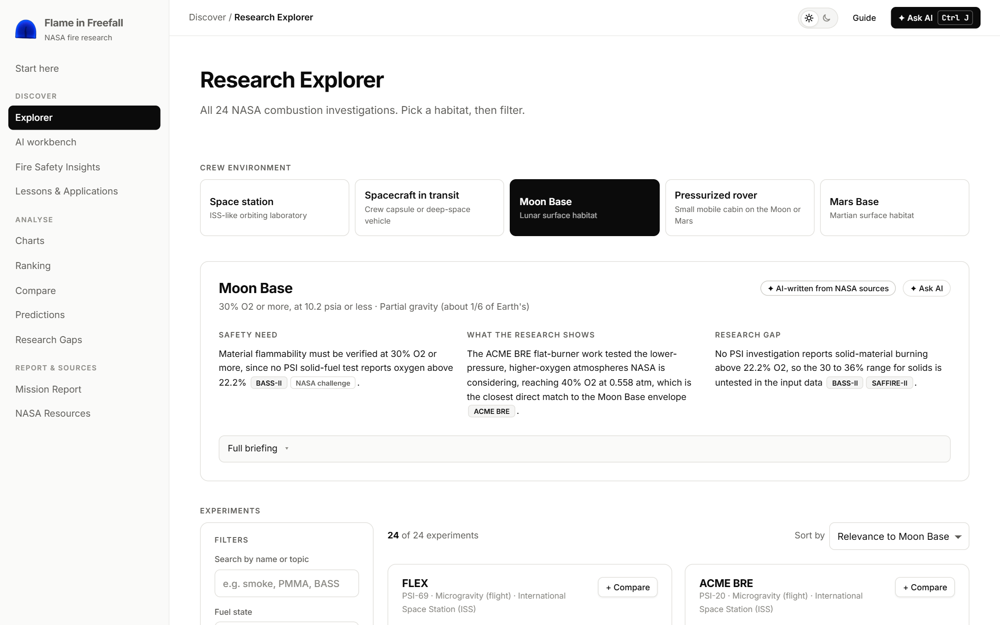

**What it does**
- **Pick a habitat first.** The page writes a short briefing for it with three parts: the safety need, what NASA's research shows, and the research gap. Each claim carries a tag naming the experiment it comes from.
- **Filter and sort.** Below the briefing, the 24 investigations can be filtered by fuel state, material, safety area (prevention, detection, suppression), gravity, facility, topic, and the oxygen, pressure and airflow ranges tested. They are sorted by relevance to the chosen habitat.

**How it is built**
- **Data pipeline:**
  - `fetch_psi.py` downloads every PSI combustion record, run table and image.
  - `build_db.py` normalises them into a SQLite database (`flame.db`): investigations, tables, runs, text passages.
- **Search:** the text search matches word stems, so "smoke detection" also finds records that say "detector".
- **Range filters:** a range filter keeps an experiment only if its tested range overlaps the requested one. An experiment that never reported a value is never matched as if it had.

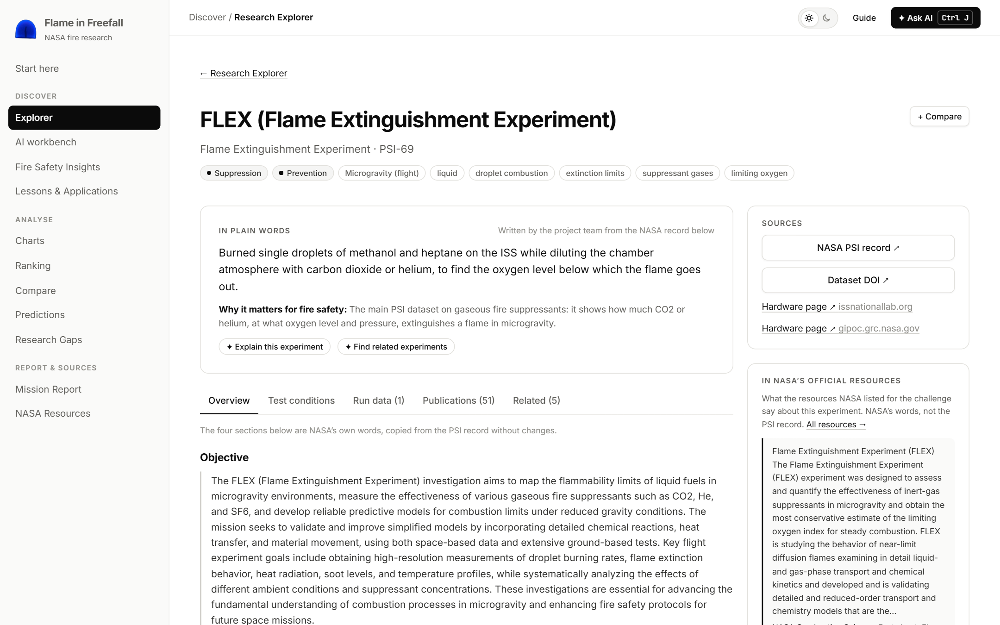

**Investigation profiles.** Each investigation has its own page with:
- a plain-language summary written by our team, clearly labelled as ours
- NASA's own record text, copied unchanged
- test conditions, run data, publications and related experiments
- links to the NASA PSI record and the dataset DOI
- what the official NASA resources say about that experiment

---

### 2.3 AI Research Assistant: answers that cannot be made up

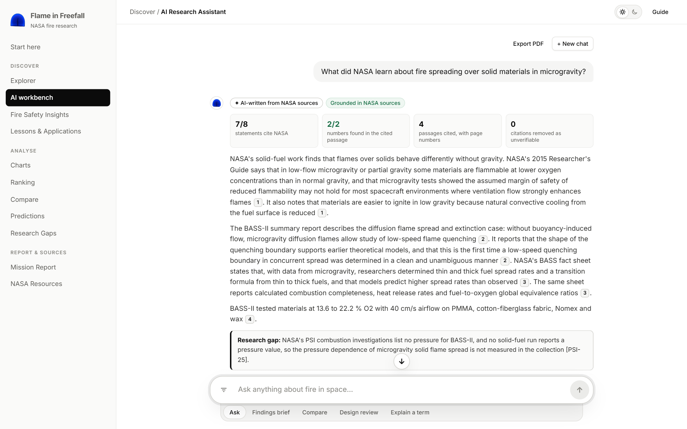

**What it does**
- **Answers from NASA only.** The assistant answers questions about fire in space using only NASA material, and cites every claim with a numbered source and its page.
- **Shows how well each answer is backed.** Above every answer, a ledger shows the checks. In the example above:
  - 7 of 8 statements cite NASA.
  - 2 of 2 numbers were found in the cited passage.
  - 4 passages are cited, with page numbers.
  - 0 citations had to be removed.
- **Ends with a research gap.** When NASA has no data, the answer names that as a research gap rather than guessing.
- **Five tasks:** Ask, Findings brief, Compare, Design review and Explain a term.
- **Wording levels:** answers can be written for different readers, from students to experts.
- **Narrow the search:** readers can limit it to chosen experiments or kinds of source.
- **Export:** a whole conversation can be exported as a PDF with a reference list.

**How it is built** (`research.py`, `retrieval.py`)

1. **Library.** NASA reports, science documents and analysed-data sheets are read page by page with `pypdf` (`build_docs.py`). The 10 official challenge resources are read too: web pages, PDFs and the video captions (`build_resources.py`). Together with the PSI records this gives **3,530 searchable passages**, each tagged with its kind (NASA report, PSI record, run table, NASA resource and so on).
2. **Hybrid search.** Two searches run on every question:
   - keyword search (TF-IDF, scikit-learn) catches exact names such as "PMMA" or "BASS-II"
   - meaning search (the BAAI bge-small-en-v1.5 model, run on our own server with FastEmbed and ONNX, with no paid API) catches passages that answer the question in other words

   The two rankings are merged with *reciprocal rank fusion*.
3. **Ask.** The best passages go to Claude (Haiku, low effort) as numbered sources. The instructions say: answer only from these sources and cite them.
4. **Check in code.** The model is not trusted to check itself:
   - every citation must point to a passage the model was actually given, or it is removed
   - the answer is split into statements, each labelled with the kind of evidence behind it
   - every number with a unit is looked up in the cited passage
   - sentences where the model talks about its own sources instead of NASA's findings are removed
5. **Stream.** The answer streams in and is written out word by word, without the page jumping.

**Without an AI key** the same search runs and the passages are quoted directly, so the site still works and nothing is generated.

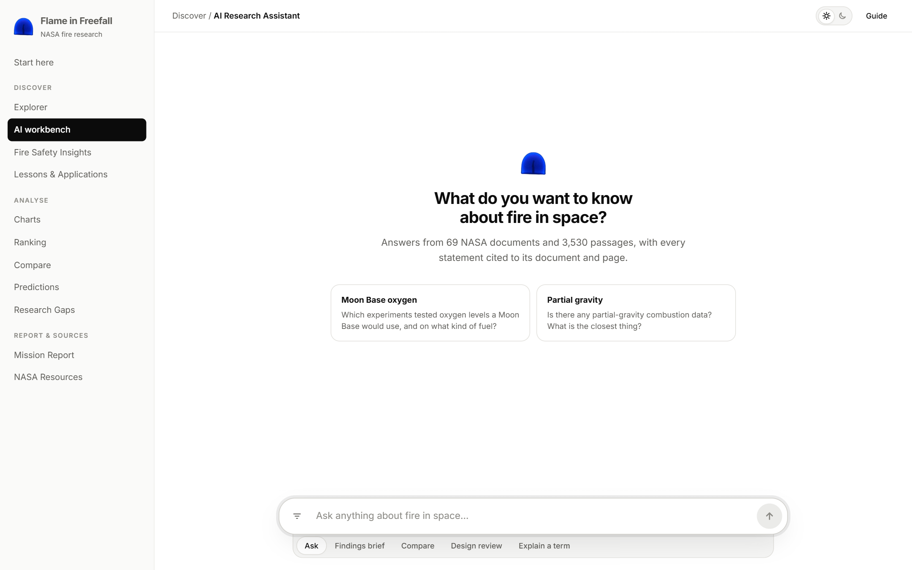

---

### 2.4 Fire Safety Insights: prevention, detection, suppression

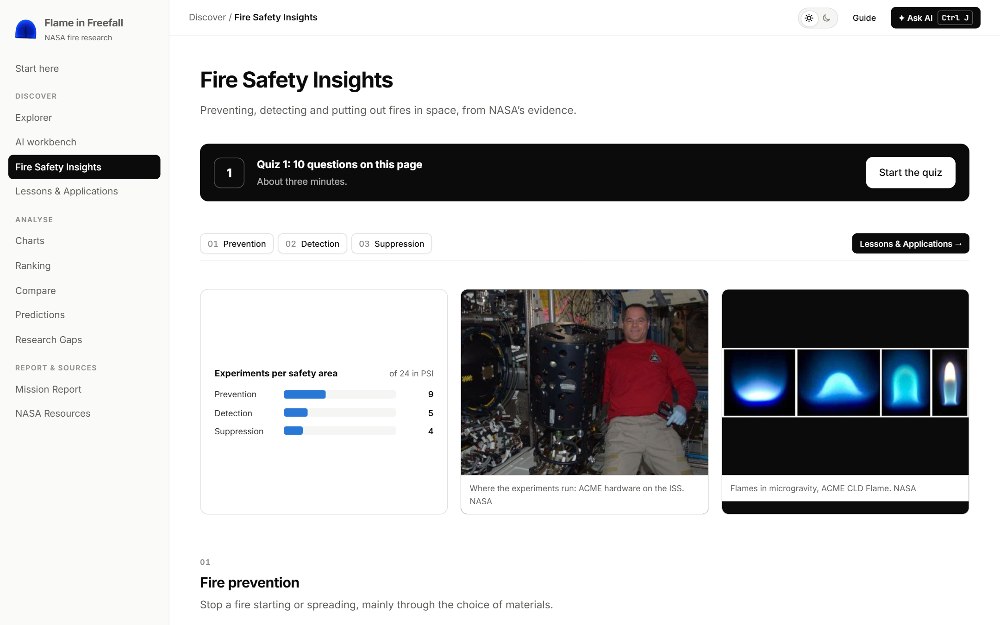

**What it does:** the three themes of the challenge, each explained with NASA's own evidence:
- **Prevention:** material flammability, oxygen limits, airflow
- **Detection:** smoke and particle sensing
- **Suppression:** CO₂, helium and other gases that put flames out

The page uses NASA photos, small charts and verbatim quotes, and ends with a 10-question quiz.

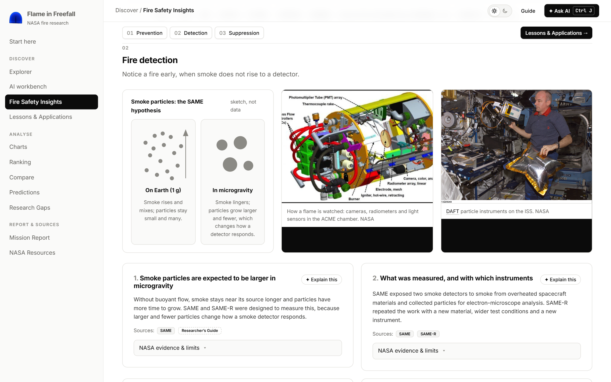

**How it is built:** every point carries a quote from a PSI record, the challenge text or an official NASA resource. When the server starts, `verify()` looks for every quote in its source. If one cannot be found, the server refuses to start, so the page can never drift from the data.

---

### 2.5 Lessons & Applications: history, physics and Earth

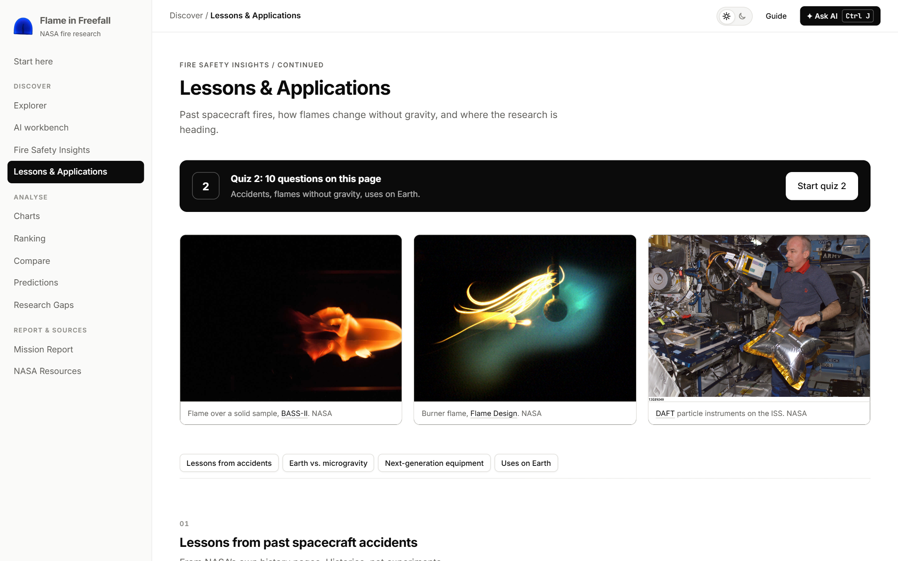

**What it does:** four sections, and a second quiz.

1. **Lessons from accidents:** Apollo 1 (1967), Apollo 13 (1970) and the Mir fire (1997), from NASA's own history pages.
2. **Earth vs. microgravity:** why a candle flame becomes a sphere, and the Saffire-II table of the same materials burned in orbit and on Earth.
3. **Next-generation equipment:** what NASA's records point to for future detectors, suppression systems and material tests.
4. **Uses on Earth:** three NASA Spinoff technologies (firefighters' air tanks, fire detectors, fire-resistant clothing), plus ground testing in drop towers.

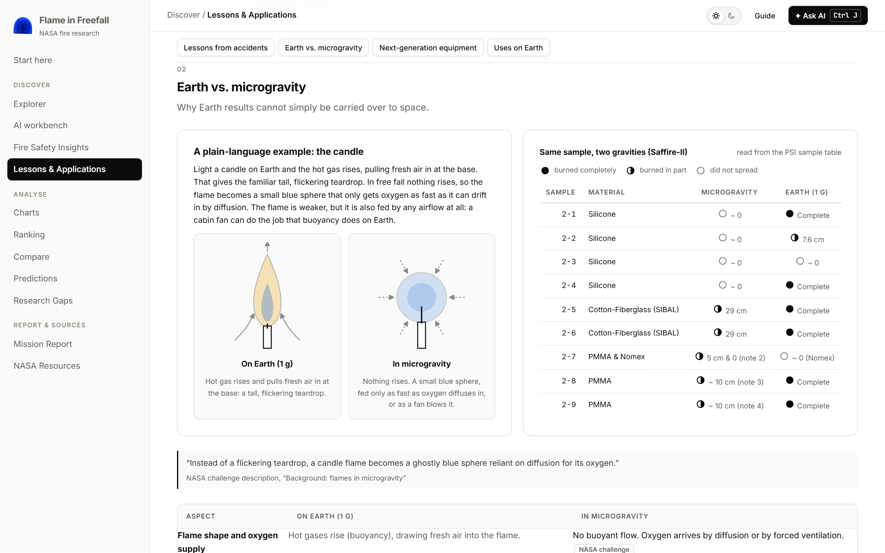

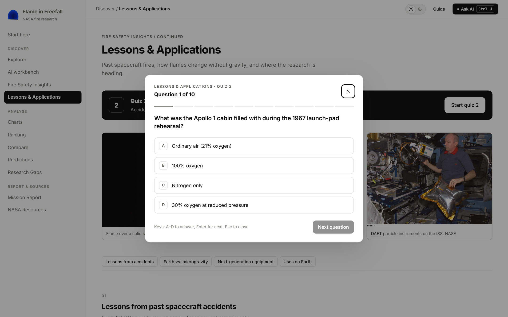

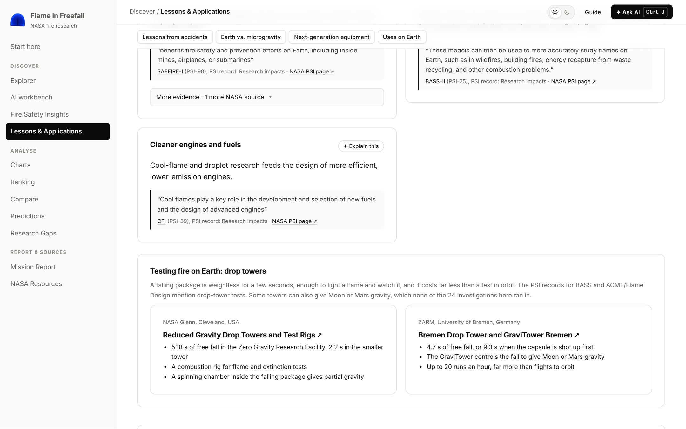

**Drop towers.** A falling package is weightless for a few seconds, enough to light a flame and watch it. We link two facilities:
- **NASA Glenn:** 5.18 s of free fall, a combustion rig, and a centrifuge for partial gravity
- **ZARM Bremen:** 4.7 s, or 9.3 s with the catapult. Its GraviTower can reproduce Moon and Mars gravity.

This points directly at the biggest gap we found: none of the 24 investigations ran in partial gravity.

---

### 2.6 Charts: NASA's measured data, interactive

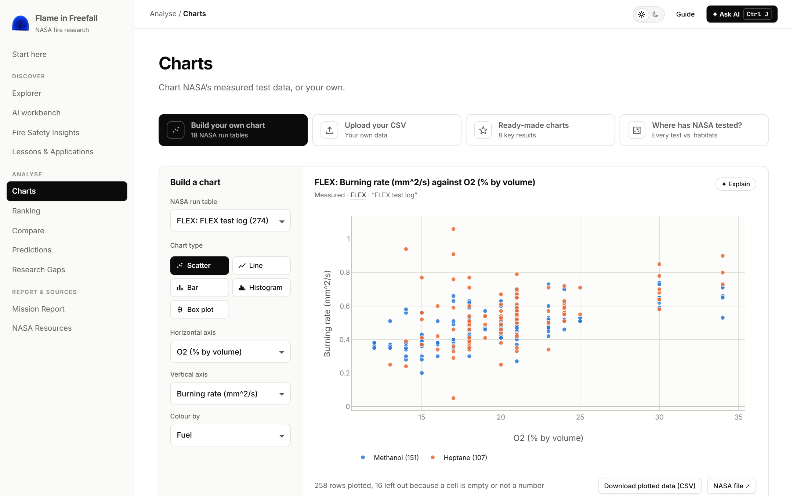

**What it does**
- **Build your own chart** from 18 NASA run tables: scatter, line, bar, histogram or box plot, coloured by any column.
- **Upload your own CSV** and chart it the same way.
- **Ready-made charts:** 8 key results.
- **Download** the plotted data as CSV, or open the original NASA file.

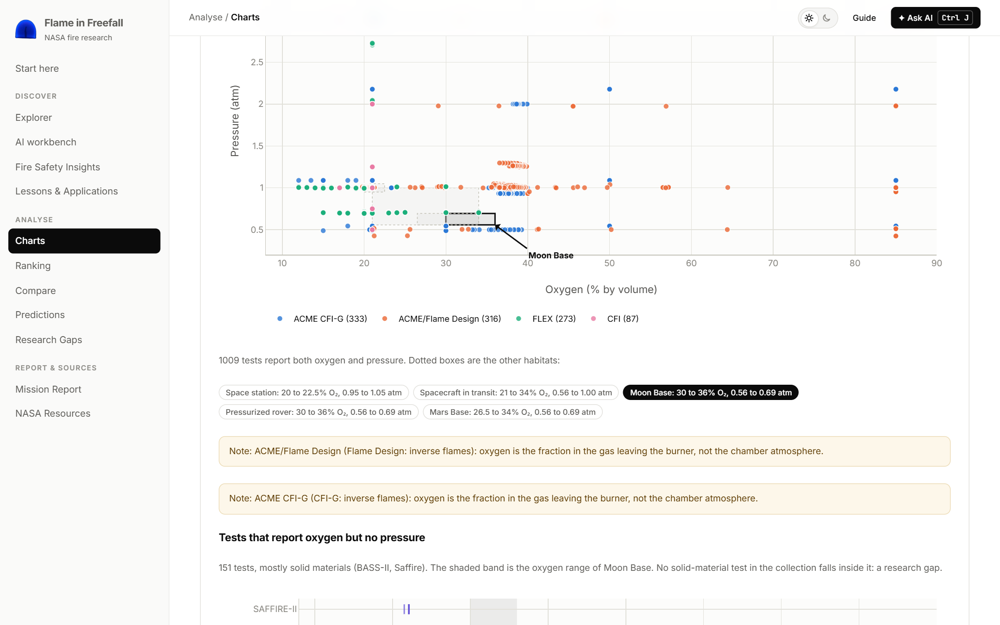

**"Where has NASA tested?"** This chart plots 1,009 NASA tests by oxygen and pressure against the cabin atmospheres of the five habitats. The Moon Base box shows at a glance which tests are relevant, and that no solid-material test falls inside it.

**How it is built**
- Charts are drawn in the browser with Plotly from run-table rows served by the API.
- Each ready-made chart names real column names, and `verify()` checks them at startup, so a chart can never show a measurement NASA's table does not contain.
- Notes warn where a column means something different, for example oxygen measured in the burner gas rather than in the chamber.

---

### 2.7 Experiment Ranking: which NASA results matter for *your* habitat

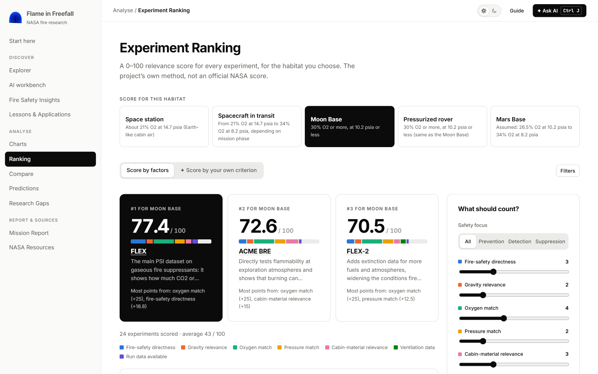

**What it does:** every investigation gets a 0–100 relevance score for the chosen habitat. For Moon Base, FLEX ranks first (77.4), followed by ACME BRE (72.6) and FLEX-2 (70.5). Each card says where its points came from, for example "oxygen match (+25), fire-safety directness (+18.8)".

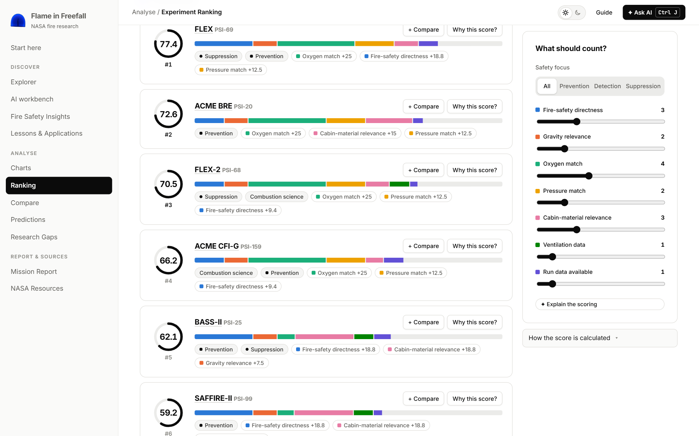

**How it is built** (`environments.py`)
- **Seven factors,** each scored 0–1 from the database: fire-safety directness, gravity relevance, oxygen match, pressure match, cabin-material relevance, ventilation data, and whether run data is available.
- **Habitat atmospheres** are taken from the NASA challenge text. For example: *"30% or greater, with a corresponding pressure of 10.2 psi or less"* for the Moon.
- **Adjustable weights.** Users can drag the weight sliders, or choose a safety focus (prevention, detection or suppression), and the ranking updates live.
- **Score by your own criterion.** The AI can also rank by a criterion the user writes in their own words, with the reasons cited.
- **Honest labelling.** The page says clearly that this is the project's own method, not a NASA score, and shows the formula and the breakdown of every result.

---

### 2.8 Compare: two to four experiments side by side

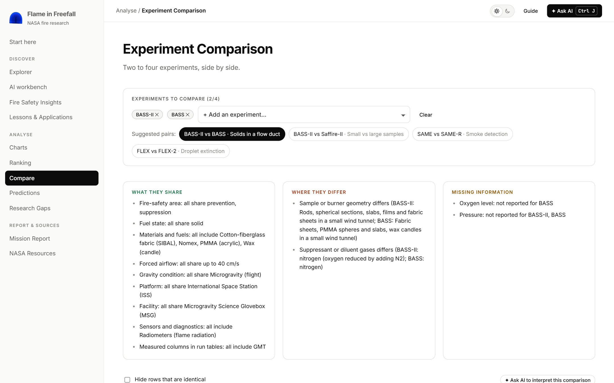

**What it does:** three summary boxes come first: what the experiments share, where they differ, and what information is missing. A full table follows, row by row. Suggested pairs (BASS-II vs BASS, SAME vs SAME-R, FLEX vs FLEX-2) make it quick to start, and the AI can interpret the comparison on request.

**How it is built:** rows come straight from the database. A missing value is shown as "Not reported" and never filled in by guessing.

---

### 2.9 Predictions: what would a fire do in this atmosphere?

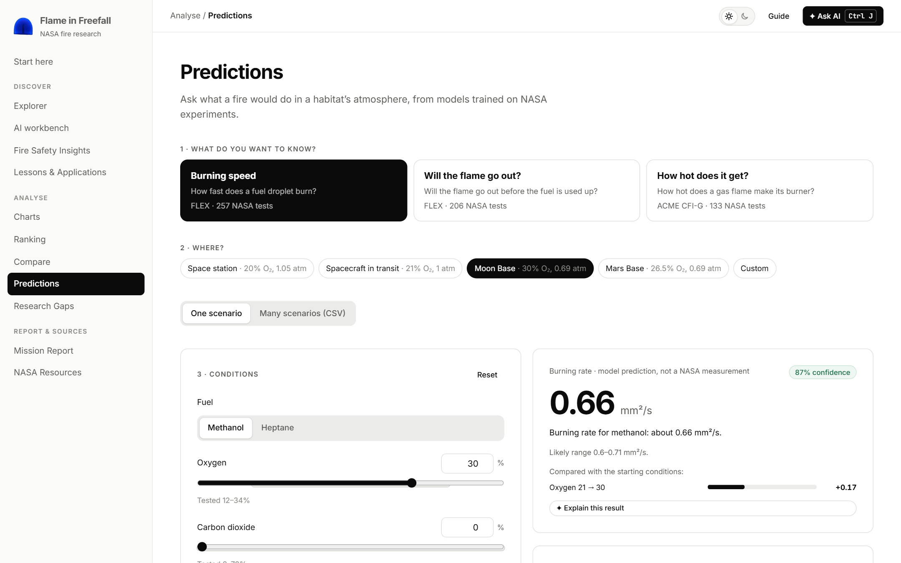

**What it does**
- **Three questions:**
  - How fast does a fuel droplet burn?
  - Will the flame go out?
  - How hot does a gas flame get?
- **Pick a habitat or set the conditions.** Choose a habitat, or set oxygen, CO₂, helium and pressure yourself. The page gives a prediction with a likely range, a confidence score, and how the result changes compared with normal cabin air.
- **Example (above):** at Moon Base air, methanol burns at about 0.66 mm²/s, with 87% confidence.
- **Many scenarios at once:** a CSV of conditions can be uploaded and every row is predicted.

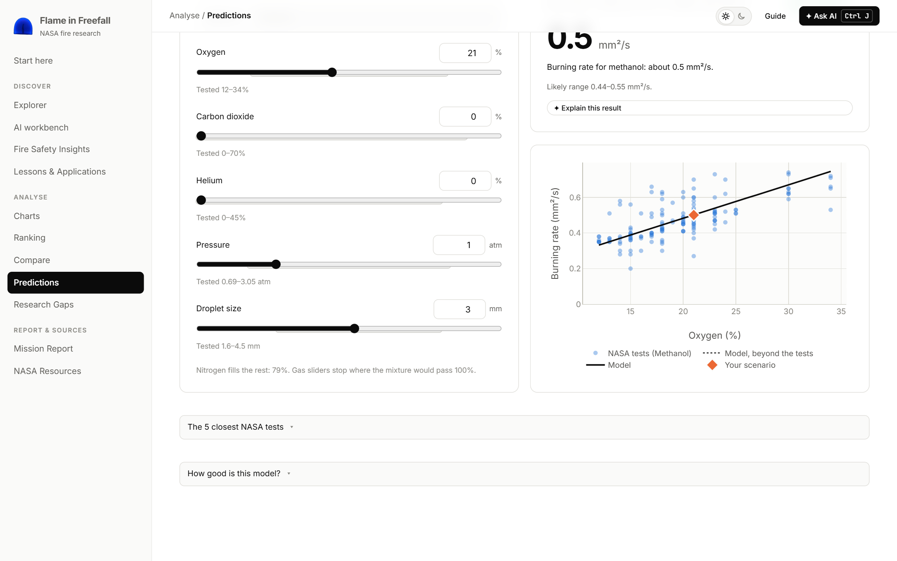

**How it is built** (`models.py`, `predict.py`, scikit-learn)

| Model | NASA data | Method | Tested accuracy |
|---|---|---|---|
| Burning speed | FLEX run log, 257 tests | Ridge regression | Typical error 0.05 mm²/s vs 0.10 for a no-model guess (**52% better**), R² 0.68 |
| Will the flame go out? | FLEX run log, 206 tests | Logistic regression with paired gas terms | Brier 0.079 vs 0.107 (**26% better**), AUC 0.90, 89% correct |
| How hot does it get? | ACME CFI-G, 133 tests | Ridge regression | Typical error 66 °C vs 134 °C (**51% better**), R² 0.67 |

The models follow strict rules:
- **Tested on unseen data.** The tests use 5-fold cross-validation grouped by test day, so tests run on the same day are never split between training and testing.
- **Must beat a guess.** A model is offered only if it cuts the error of the no-model guess by at least 20%. Two candidate models failed this test (CFI-G ignition and burn time). They are not shown, and the code says why.
- **Confidence falls with distance.** The score drops as the request moves away from real NASA tests, and the likely range widens. Outside a tested range the result is labelled an extrapolation.
- **Impossible inputs are refused.** An atmosphere whose gases add up to more than 100% gets no number.
- **Labelled as a prediction.** Every output says "model prediction, not a NASA measurement".

---

### 2.10 Research Gaps: what NASA has not tested

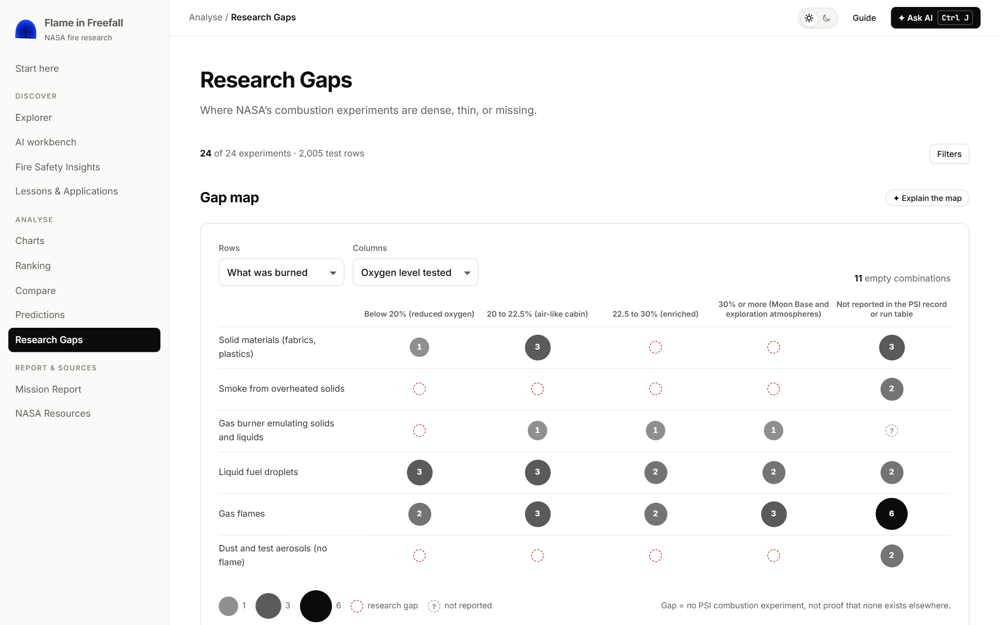

**What it does:** a gap map crosses *what was burned* with *the oxygen level tested*, or other pairs the user picks. It shows how many investigations fill each cell; red dashed circles are empty combinations. With all 24 investigations there are **11 empty combinations**. For example, no solid material has been tested above 22.5% oxygen, yet a Moon base will have 30% or more. The page also lists the main gaps and suggests research questions.

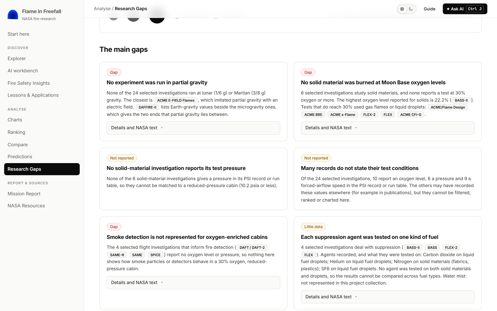

**How it is built** (`gaps.py`): everything is counted from the database for the investigations that pass the user's filters. A gap means "not in this NASA collection", never a claim that no such research exists anywhere, and the page says so.

---

### 2.11 Mission Report: one click, one PDF

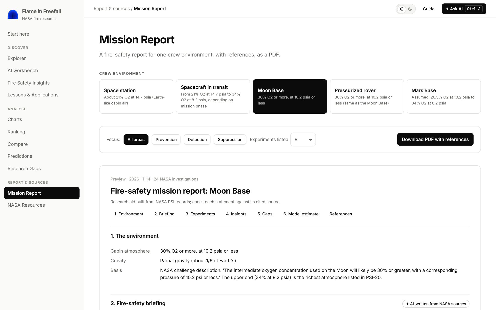

**What it does:** for any habitat, the page builds a fire-safety report with six sections and a reference list, previewed on the page and downloadable as a PDF:
1. The environment
2. An AI-written briefing from NASA sources
3. The most relevant experiments
4. Fire-safety insights
5. Research gaps
6. The model estimate

The report can be focused on prevention, detection or suppression.

**How it is built** (`mission.py`, `fpdf2`): the report computes nothing new. Each part comes from the module that owns it (ranking, insights, gaps, predictions), so the report always agrees with the rest of the site. Every statement carries a reference.

---

### 2.12 NASA Resources: full transparency on the data

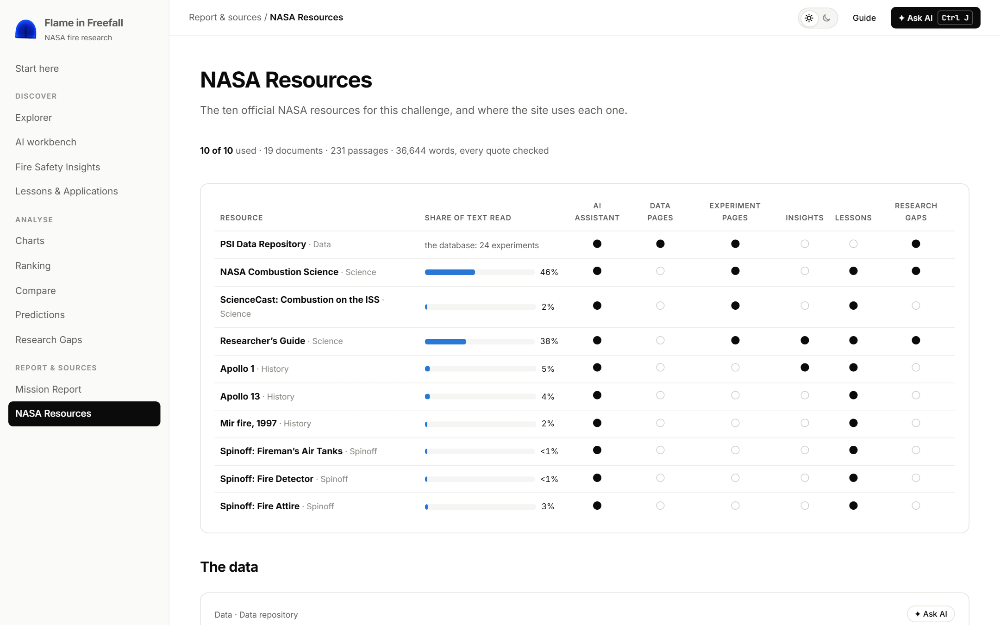

**What it does:** this page lists the 10 official NASA resources for the challenge. All 10 are used: 19 documents, 231 passages and 36,644 words, with every quote checked. For each resource it shows:
- what share of its text was read and used
- which parts of the site use it (AI assistant, data pages, experiment pages, Insights, Lessons, Research Gaps)

Any file that could not be read is listed with the reason, not hidden.

---

## 3. Benefits

- **For mission planners and engineers:** a ranked, cited answer to "which NASA results apply to my habitat?" in minutes instead of weeks of reading, plus a PDF report ready to share.
- **For researchers:** fast search across 3,530 NASA passages with page-level citations. Side-by-side comparison, interactive charts of the raw run data, and a map of untested conditions to guide new experiments.
- **For students and teachers:** four levels of explanation, two quizzes, NASA photos and real data to learn from and teach with.
- **For everyone:** trust. Every number can be traced to NASA, and every prediction says how sure it is.

## 4. Intended impact

Fire is one of the most dangerous emergencies in space. There is nowhere to escape, and help is days or months away. As NASA prepares for long stays on the Moon and missions to Mars, crews will live in oxygen-rich, low-pressure atmospheres where fire has barely been studied.

Our goal is to make sure that knowledge is used:
- **Show what is already known.** Bring NASA's decades of combustion results to the people designing future habitats, in a form they can act on.
- **Show what is still unknown.** Gaps such as partial gravity and solid materials above 22.5% oxygen become a clear agenda for the next experiments, including affordable ground tests in drop towers.
- **Teach the next generation.** Students learn fire safety in space from real NASA data, at their own level.

## 5. Tools, languages and software

| Area | Tools |
|---|---|
| Languages | Python (backend, data pipeline, machine learning), TypeScript (frontend) |
| Backend | FastAPI, Uvicorn, SQLite |
| Data processing | pandas, pypdf (reading NASA PDFs page by page) |
| Machine learning | scikit-learn: ridge regression, logistic regression, GroupKFold cross-validation, TF-IDF search |
| Meaning search | BAAI bge-small-en-v1.5 embedding model, run locally with FastEmbed (ONNX) |
| AI assistant | Anthropic Claude API (Claude Haiku), with streaming answers |
| PDF reports | fpdf2 |
| Frontend | React 19, React Router, Vite |
| Charts | Plotly.js |
| Formatting AI answers | react-markdown, remark-gfm |
| Screenshots and testing | Playwright, plus a 100-check automated test suite and an end-to-end test of the live site |
| Hosting | Render (one service serves the API and the website) |
| Hardware | None. Everything runs on a standard laptop and a small cloud server. |

**Data:**
- **NASA PSI combustion repository:** 24 investigations, 22 run tables, PSI images and documents.
- **The 10 official NASA challenge resources:**
  - NASA Combustion Science
  - the Researcher's Guide to ISS Combustion Science
  - the NASA ScienceCast video and its captions
  - Apollo 1 and Apollo 13 (NASA Safety Center)
  - the Mir fire (NASA History)
  - three NASA Spinoff articles, read in full from NASA's Technical Reports Server
- **NASA Glenn's drop-tower facility page and ZARM Bremen,** for ground testing.

## 6. How the project is creative

- **Habitat first, not database first.** Instead of another list of experiments, the site asks *where will the crew live?* and re-orders all of NASA's evidence around that atmosphere.
- **An AI that is checked by code.** Most AI tools ask the model to be accurate. Ours removes citations that point to nothing, looks up every number in its source, and shows the reader a ledger of how well each answer is backed.
- **Predictions that admit their limits.** Models are offered only if they beat a simple guess on unseen test days. Confidence falls away from real tests, and models that failed the test are left out openly.
- **Missing data becomes a result.** The Research Gaps map and the habitat chart show where NASA has *not* tested, and link to the facilities that could close those gaps.
- **One source of truth.** The Mission Report, the AI and every page draw on the same checked data, so they can never disagree.

## 7. Factors our team considered

- **Accuracy over impressiveness.**
  - Every quote is verified at startup.
  - Every model prediction is labelled as a prediction, never a NASA measurement.
  - Our own methods (the relevance score, the plain-language summaries) are labelled as ours, not NASA's.
- **Honest limits.** Each model lists what it does not cover; for example, droplets are not cabin fabrics. A research gap means "not in this collection", not "never studied".
- **Different readers.** Four levels from beginner to expert, plain-language explanations next to NASA's original wording, and two quizzes.
- **Works without AI.** If the AI is unavailable, every page still works and the assistant quotes NASA passages directly.
- **Cost and speed.**
  - We chose a small, fast model (Claude Haiku, low effort): about $0.002 and 4–11 seconds per answer.
  - Meaning search runs on our own server at no cost per question.
  - The whole site fits on a small cloud server with 512 MB of memory.
- **Accessibility and design.** Light and dark modes, phone and desktop layouts, motion that respects "reduce motion" settings, and keyboard shortcuts.

  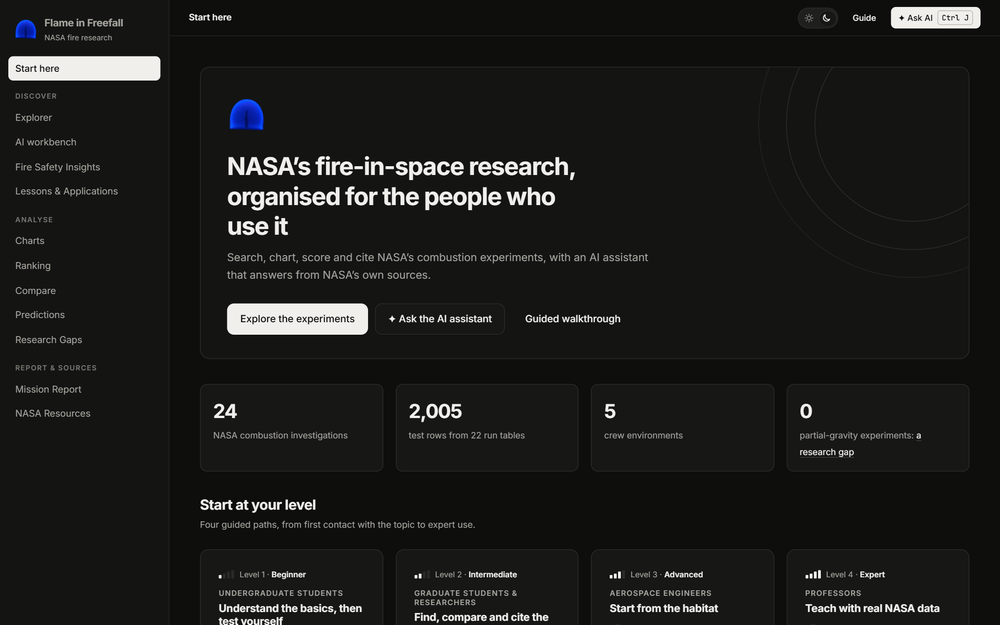

  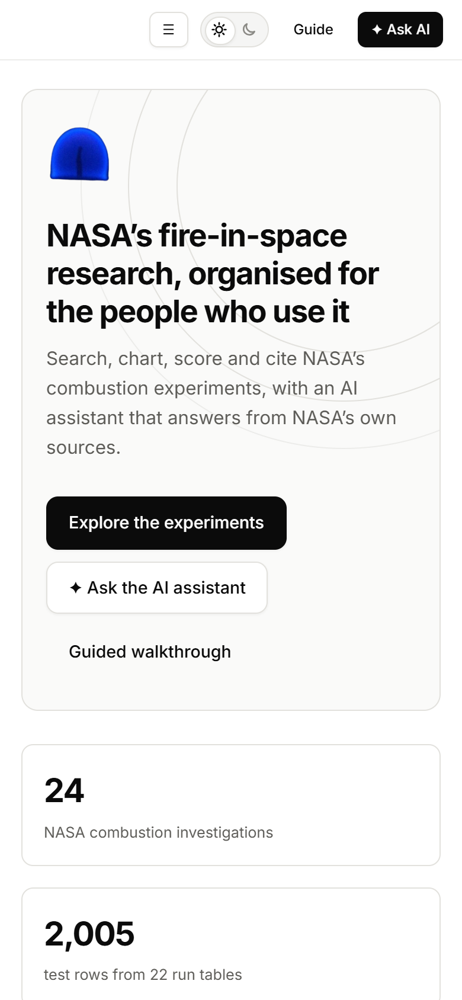 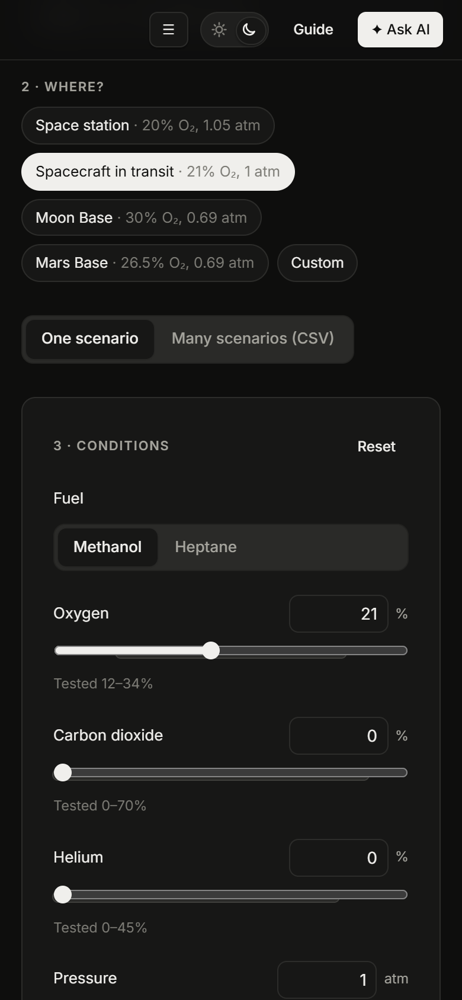
- **Testing.** A 100-check test suite runs locally. An end-to-end test of the live site checks every page and feature, including real AI answers and PDF downloads.
